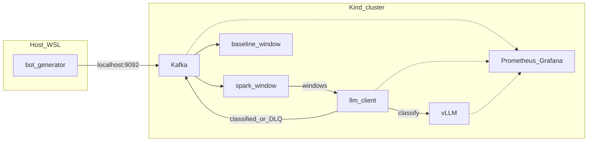

# RoboFleet Telemetry Engine

Kubernetes-native stream processing and MLOps platform. A simulated fleet of
autonomous robots emits telemetry and unstructured logs; events are processed
in real time and classified via local GPU LLM inference (mock classifier when
no GPU is available).

## Architecture



| Runs on | Components |
|---------|------------|
| **Host (WSL)** | Python venv, `bot_generator.py` / `kafka_sink.py`, `.env`, bench scripts |
| **Kind** | Strimzi Kafka, Spark + baseline window Deployments, llm-client, vLLM, Prometheus / Grafana / DCGM |

### Kafka host ports

Kind maps host ports into the node (see `k8s/kind/cluster-config.yaml`). Details:
[docs/module-2.md](docs/module-2.md) §2.3.

| Host | NodePort | Role |
|------|----------|------|
| `localhost:9092` | 30092 | External bootstrap (`KAFKA_BOOTSTRAP_SERVERS`) |
| `localhost:9093` | 30093 | Broker advertised address for host clients |

## What you can reproduce

| Path | Needs | Covers |
|------|-------|--------|
| **CPU** | Docker Desktop WSL2, `kubectl` / `kind` / `helm`, no NVIDIA GPU | Modules 1–3 with `CLASSIFIER=mock`; Module 5 without DCGM / vLLM panels |
| **GPU** | Above + Docker `default-runtime=nvidia`, visible NVIDIA GPU (validated on RTX 4090), Kind GPU node image + RuntimeClass | Module 4 vLLM + DCGM / full Module 5 dashboard |

Without a GPU, do **not** expect vLLM pods or DCGM exporter to become Ready.

## Prerequisites

- Python 3.11+ (developed on 3.14)
- Git
- Module 2+: Docker Desktop (WSL2 backend), `kubectl`, `kind`, `helm`

## Setup

```bash
python3 -m venv .venv
source .venv/bin/activate
pip install -r requirements.txt
```

## CPU quickstart

End-to-end without a GPU (mock classifier). Assumes a Kind cluster created from
`k8s/kind/cluster-config.yaml` ([module-2](docs/module-2.md)).

```bash
source .venv/bin/activate
./scripts/kafka-install.sh
./scripts/stream-install.sh
# Checked-in llm-client defaults to CLASSIFIER=vllm; force mock for CPU-only:
kubectl -n robofleet set env deployment/llm-client CLASSIFIER=mock
kubectl -n robofleet rollout status deployment/llm-client

cp -n .env.example .env
set -a && source .env && set +a
python bot_generator.py --eps 5 --bots 100
```

Optional observability (**consumer lag** + **classify latency**; skip DCGM if no GPU):

```bash
./scripts/observability-install.sh
# Grafana: http://localhost:30300  (admin / robofleet)
# Prometheus: http://localhost:30090
```

## GPU quickstart

Host GPU visibility and a Kind node that can inject the device come **first**.
Full checklist: [docs/module-4.md](docs/module-4.md).

```bash
./scripts/gpu-install.sh   # RuntimeClass + device plugin + vLLM + DLQ topic
# Ensure llm-client uses vLLM (repo default after stream-install):
kubectl -n robofleet set env deployment/llm-client CLASSIFIER=vllm
```

Then generate load as in the CPU quickstart and open Grafana
([docs/module-5.md](docs/module-5.md)).

## Module runbooks

- Module 1: telemetry generator — [docs/module-1.md](docs/module-1.md)
- Module 2: Kind + Strimzi Kafka + host producer — [docs/module-2.md](docs/module-2.md)
- Module 3: PySpark + baseline + LLM client — [docs/module-3.md](docs/module-3.md)
- Module 4: in-cluster vLLM on GPU — [docs/module-4.md](docs/module-4.md)
- Module 5: Prometheus / Grafana / DCGM — [docs/module-5.md](docs/module-5.md)

Contracts: [telemetry v1](docs/event-schema-v1.md), [windows v1](docs/window-schema-v1.md),
[classified v1](docs/classified-schema-v1.md).

Metrics glossary (offered EPS, window emission / classify latency, consumer lag;
no end-to-end latency): [docs/metrics.md](docs/metrics.md).

Blueprint notes (agent context): [PROJECT_PLAN.md](PROJECT_PLAN.md).

## Known limitations

- Single-node Kind; Kafka KRaft with replication factor 1; PLAINTEXT (no TLS / auth)
- Spark runs `local[2]` in one pod; baseline window state is in-memory (no checkpoint)
- Local demo Grafana password in Helm values; not for shared/production use
- vLLM typically pins high GPU frame-buffer use; `RoboFleetGpuMemoryHigh` may stay firing
- No end-to-end latency metric; **broker-acked EPS** and **p99** are not collected
  (see [docs/metrics.md](docs/metrics.md))
- Not a multi-AZ or horizontally scaled production deployment

## Test

```bash
python -m unittest discover -s tests -v
python -m py_compile bot_generator.py kafka_sink.py stream/*.py services/llm_client/*.py
```
